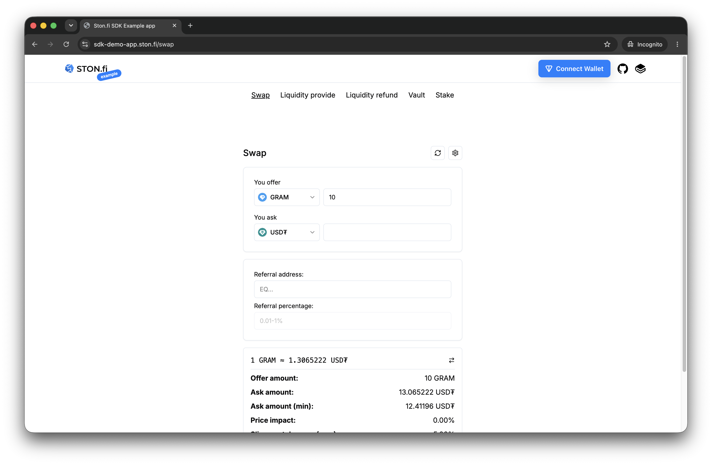

# STON.fi SDK React example app

STON.fi maintains this React example app to demonstrate integration with `@ston-fi/sdk` and `@ston-fi/stake-sdk` in React and Next.js. Use its source code alongside the official [SDK documentation](https://docs.ston.fi/docs/developer-section/sdk).

Try the live example app at [sdk-demo-app.ston.fi](https://sdk-demo-app.ston.fi).



The app demonstrates token swaps, liquidity provision and refunds, vault fee withdrawal, and staking. It uses the STON.fi API for asset and pool data and swap simulations, TON RPC and TonAPI for blockchain data, and TonConnect for wallet connection and transaction signing.

> [!WARNING]
> This example app is intended for integration guidance and is not production-ready.

## Development

Use Node.js 24 and pnpm 10.20.0 (the version pinned in the root `package.json`). From the repository root, install dependencies and start the example app:

```sh
pnpm install
pnpm dev
```

The root development command builds the local SDK packages before starting Next.js. Open [localhost:3000](http://localhost:3000) once the server is ready.

The app includes default mainnet endpoints and staking contract addresses. To customize them, add local overrides in `examples/next-js-app/.env.development.local`.

## Deployment

For deployment options and instructions, see the official [Next.js deployment documentation](https://nextjs.org/docs/app/getting-started/deploying).
